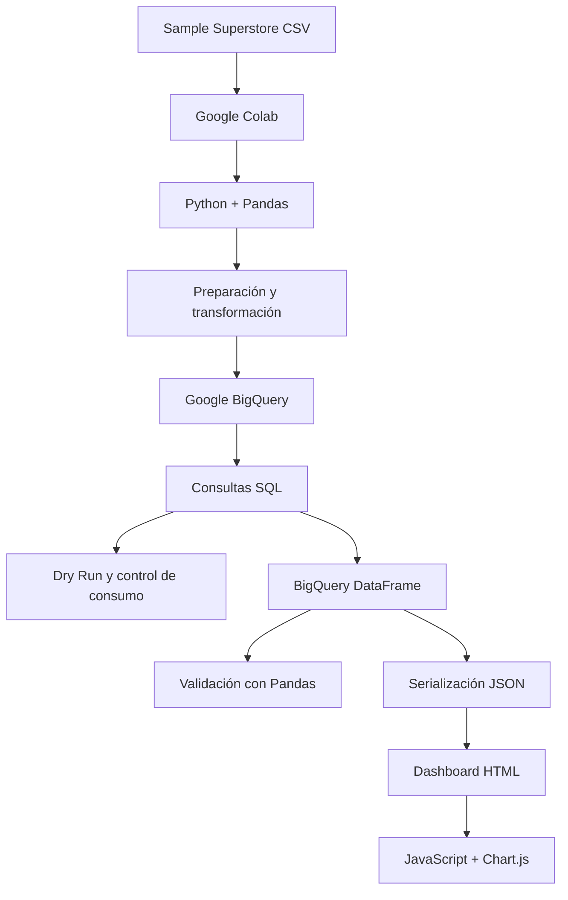
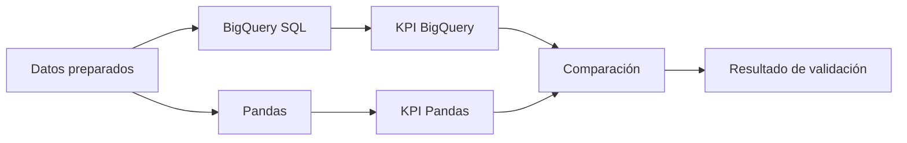

# Arquitectura técnica del sistema

## 1. Propósito

Este documento describe la arquitectura técnica utilizada para implementar el artefacto presentado en el artículo:

**“Arquitectura analítica cloud de bajo costo de entrada para PYMEs del sector retail”.**

La solución fue diseñada como una arquitectura analítica mínima, reproducible y verificable, orientada a organizaciones que necesitan capacidades básicas de análisis de datos sin desplegar una plataforma empresarial compleja.

---

## 2. Vista general

La arquitectura implementa el siguiente flujo:



---

## 3. Componentes

La arquitectura se organiza en cinco componentes principales:

1. Fuente de datos.
2. Preparación y transformación.
3. Persistencia analítica.
4. Validación.
5. Visualización.

---

# 4. Componente 1: fuente de datos

## Entrada

El artefacto utiliza el conjunto:

**Sample Superstore**

Características utilizadas:

- 9.994 registros.
- 21 variables originales.
- Periodo 2014–2017.
- Información sobre pedidos, clientes, ventas, beneficio, productos y regiones.

El dataset funciona como banco de pruebas técnico.

No se considera evidencia empírica obtenida directamente de una PYME real.

---

## Salida

El archivo CSV es cargado en un DataFrame de Pandas.

```text
CSV
 ↓
Pandas DataFrame
```

---

# 5. Componente 2: preparación y transformación

## Tecnología

- Google Colab.
- Python.
- Pandas.

## Responsabilidades

Esta etapa realiza:

- carga de datos;
- normalización de columnas;
- conversión de fechas;
- validación inicial;
- conversión de variables numéricas;
- creación de variables derivadas.

---

## Variables derivadas

Se generan siete variables:

```text
year
month_number
month_name
year_month
month_start
profit_margin
shipping_days
```

Después de las transformaciones:

```text
21 variables originales
+
7 variables derivadas
=
28 variables
```

---

## Salida

El resultado es un DataFrame preparado para carga analítica.

```text
Pandas DataFrame preparado
            ↓
        BigQuery
```

---

# 6. Componente 3: almacenamiento analítico

## Tecnología

**Google BigQuery**

Configuración utilizada en el estudio:

```text
PROJECT_ID:
retailanalytics2026

DATASET_ID:
retail_analytics

TABLE_ID:
superstore_sales
```

Tabla completa:

```text
retailanalytics2026.retail_analytics.superstore_sales
```

En una reproducción externa debe modificarse únicamente el identificador del proyecto y, si se desea, los nombres del dataset y tabla.

---

## Responsabilidades

BigQuery se utiliza para:

- almacenar el conjunto preparado;
- ejecutar consultas SQL;
- calcular KPI;
- agrupar datos;
- aplicar filtros;
- estimar volumen de datos procesados;
- devolver resultados hacia Python.

---

# 7. Modelo de almacenamiento

La arquitectura utiliza una tabla analítica principal:

```text
superstore_sales
```

Cada registro representa una línea de pedido del conjunto Sample Superstore.

La tabla contiene variables relacionadas con:

- pedido;
- cliente;
- producto;
- ubicación;
- fechas;
- ventas;
- beneficio;
- descuento;
- cantidades;
- variables temporales derivadas.

---

# 8. Capa de consulta

Las consultas son ejecutadas directamente sobre BigQuery mediante SQL.

Ejemplo de KPI:

```sql
SELECT
    SUM(sales) AS total_sales,
    SUM(profit) AS total_profit,
    SAFE_DIVIDE(
        SUM(profit),
        SUM(sales)
    ) AS profit_margin,
    COUNT(DISTINCT order_id) AS orders,
    COUNT(DISTINCT customer_id) AS customers
FROM
    `retailanalytics2026.retail_analytics.superstore_sales`;
```

---

# 9. Indicadores

Los cinco KPI utilizados son:

## Ventas

```text
SUM(sales)
```

## Beneficio

```text
SUM(profit)
```

## Margen

```text
SUM(profit) / SUM(sales)
```

## Pedidos

```text
COUNT(DISTINCT order_id)
```

## Clientes

```text
COUNT(DISTINCT customer_id)
```

---

# 10. Control de consumo

La arquitectura utiliza **BigQuery Dry Run** antes de determinadas consultas.

El flujo es:

```text
Consulta SQL
     ↓
Dry Run
     ↓
Estimación de bytes
     ↓
Evaluación previa
     ↓
Ejecución
```

Dry Run permite estimar el volumen que sería procesado sin ejecutar la consulta.

Esto permite incorporar un mecanismo explícito de control de consumo.

---

# 11. Reducción de datos procesados

En el escenario evaluado se compararon consultas específicas contra una consulta:

```sql
SELECT *
```

Se obtuvieron reducciones aproximadas de:

```text
Ventas + beneficio:
94,93 %

Agrupación por categoría:
90,25 %

Top 10 productos:
85,10 %
```

Estos resultados corresponden exclusivamente:

- al dataset evaluado;
- al esquema utilizado;
- a las consultas analizadas.

No deben interpretarse como valores universales para cualquier implementación.

---

# 12. Recuperación desde BigQuery

Después del procesamiento analítico, los datos son recuperados hacia Python.

```text
BigQuery
   ↓
google-cloud-bigquery
   ↓
Pandas DataFrame
```

Ejemplo:

```python
df_bq = (
    client.query(query)
          .to_dataframe()
)
```

---

# 13. Componente 4: validación

La validación utiliza dos rutas de cálculo.



---

## Ruta A

```text
BigQuery
+
SQL
```

## Ruta B

```text
Pandas
+
Python
```

BigQuery funciona como referencia de cálculo.

Pandas funciona como ruta independiente de reproducción.

---

# 14. Escenarios de validación

Se evaluaron:

```text
20 escenarios
×
5 KPI
=
100 comprobaciones
```

Los escenarios incluyen:

- análisis global;
- años;
- regiones;
- categorías;
- segmentos;
- combinaciones múltiples de filtros.

---

# 15. Criterios de comparación

Para KPI continuos:

```text
Ventas
Beneficio
Margen
```

se utilizan tolerancias numéricas.

Para:

```text
Pedidos
Clientes
```

se compara igualdad de conteos únicos.

---

# 16. Resultado de validación

La ejecución documentada obtuvo:

```text
100 / 100 comprobaciones coincidentes
```

La interpretación utilizada es:

**coincidencia funcional del 100 % en los escenarios evaluados.**

Esto no representa una afirmación de exactitud universal.

---

# 17. Componente 5: visualización

## Tecnologías

- HTML.
- CSS.
- JavaScript.
- Chart.js.

---

## Flujo

```text
BigQuery
   ↓
Pandas DataFrame
   ↓
JSON
   ↓
HTML
   ↓
JavaScript
   ↓
Chart.js
```

---

# 18. Modelo del dashboard

El dashboard recibe los datos serializados como JSON.

Posteriormente JavaScript realiza:

- filtrado;
- cálculo de KPI;
- actualización de gráficos;
- actualización de tablas;
- interacción con el usuario.

---

# 19. Filtros del dashboard

La implementación contempla filtros por:

```text
Año
Región
Categoría
Segmento
```

Los indicadores y gráficos se recalculan sobre el conjunto filtrado.

---

# 20. Naturaleza de la conexión

El dashboard no mantiene una conexión en tiempo real con BigQuery.

La arquitectura utilizada es:

```text
BigQuery
    ↓
Extracción
    ↓
DataFrame
    ↓
JSON
    ↓
Dashboard
```

Por tanto, el dashboard representa una instantánea del conjunto disponible en el momento de generación.

---

# 21. Actualización de información

Cuando existen nuevos datos debe ejecutarse nuevamente:

```text
Preparación
    ↓
Carga BigQuery
    ↓
Consulta
    ↓
Recuperación
    ↓
Generación HTML
```

---

# 22. Rol de Gemini

Gemini fue utilizado exclusivamente como apoyo de programación durante la construcción de la interfaz del dashboard.

Gemini no realizó:

- preparación del dataset;
- carga a BigQuery;
- consultas SQL;
- cálculo de KPI;
- estimación de consumo;
- validación BigQuery–Pandas.

Esta delimitación forma parte de la trazabilidad metodológica del estudio.

---

# 23. Arquitectura reproducible

Una instancia independiente puede utilizar:

```text
PROJECT_ID = "nuevo-proyecto"
DATASET_ID = "retail_analytics"
TABLE_ID = "superstore_sales"
```

sin modificar la lógica analítica.

La arquitectura se basa en configuración y no en dependencia de una cuenta específica.

---

# 24. Configuración parametrizable

La aplicación debe evitar valores sensibles incrustados directamente en el código.

Ejemplo:

```python
PROJECT_ID = "TU_PROJECT_ID"
DATASET_ID = "retail_analytics"
TABLE_ID = "superstore_sales"

FULL_TABLE = (
    f"{PROJECT_ID}."
    f"{DATASET_ID}."
    f"{TABLE_ID}"
)
```

---

# 25. Seguridad

No forman parte de la arquitectura publicada:

- credenciales;
- tokens;
- claves privadas;
- archivos de servicio;
- contraseñas.

La autenticación debe realizarse desde el entorno correspondiente.

---

# 26. Características de bajo costo de entrada

El concepto de bajo costo de entrada se fundamenta técnicamente en:

- servicios administrados;
- ausencia de servidores dedicados;
- utilización de Google Colab;
- almacenamiento reducido en el escenario experimental;
- consultas controladas;
- uso de Dry Run;
- selección de columnas;
- dashboard estático portable;
- ausencia de infraestructura permanente para la visualización.

---

# 27. Delimitación económica

La arquitectura no demuestra un costo total de propiedad universal.

El estudio se limita a analizar:

- consumo de almacenamiento;
- volumen procesado;
- costo potencial de consulta;
- comportamiento dentro del escenario evaluado.

No se incluyen:

- horas de desarrollo;
- capacitación;
- soporte;
- mantenimiento;
- migración;
- gobierno de datos;
- operación organizacional.

---

# 28. Escalabilidad

La arquitectura utiliza servicios que técnicamente permiten operar con mayores volúmenes.

Sin embargo, el estudio no realizó pruebas experimentales de:

- concurrencia;
- latencia;
- carga;
- estrés;
- rendimiento masivo;
- usuarios simultáneos.

Por ello no se afirma que la escalabilidad haya sido demostrada experimentalmente.

---

# 29. Proyección de almacenamiento

La proyección a mayores volúmenes se interpreta exclusivamente como:

**proyección teórica de almacenamiento.**

No representa una prueba de escalabilidad.

---

# 30. Dependencias principales

La implementación utiliza:

```text
Python
Pandas
NumPy
google-cloud-bigquery
google-auth
google-cloud-bigquery-storage
PyArrow
db-dtypes
```

Las versiones definidas para reproducción están documentadas en:

```text
requirements.txt
```

---

# 31. Separación de responsabilidades

| Componente | Responsabilidad |
|---|---|
| Dataset | Fuente de información |
| Pandas | Preparación y transformación |
| BigQuery | Persistencia y cálculo analítico |
| SQL | Consultas y agregaciones |
| Dry Run | Estimación de consumo |
| Pandas de validación | Reproducción independiente |
| JSON | Transporte hacia visualización |
| JavaScript | Interacción y filtros |
| Chart.js | Visualización |
| HTML/CSS | Presentación |

---

# 32. Portabilidad

La arquitectura puede adaptarse a otra cuenta de Google Cloud modificando principalmente:

```text
PROJECT_ID
DATASET_ID
TABLE_ID
```

Las reglas analíticas pueden conservarse mientras se mantenga un esquema compatible.

---

# 33. Reproducibilidad

La arquitectura se documenta junto con:

- manual de replicación;
- código fuente;
- consultas SQL;
- scripts de validación;
- dependencias;
- configuración de ejemplo;
- dashboard;
- evidencia de validación.

Estos elementos se encuentran organizados dentro del repositorio asociado al artículo.

---

# 34. Limitaciones

La arquitectura documentada no debe interpretarse como una plataforma empresarial completa.

No contempla:

- gobierno de datos;
- catálogo corporativo;
- control de acceso empresarial;
- monitoreo productivo;
- alta disponibilidad;
- recuperación ante desastres;
- CI/CD;
- ingestión en tiempo real;
- procesamiento distribuido propio;
- evaluación de experiencia de usuario.

---

# 35. Repositorio

El código y documentación asociados se encuentran en:

```text
https://github.com/javier1982/retail-cloud-analytics-architecture
```

---

# 36. Documentación relacionada

Consultar también:

```text
docs/MANUAL_REPLICACION.md
```

para obtener el procedimiento completo paso a paso.
